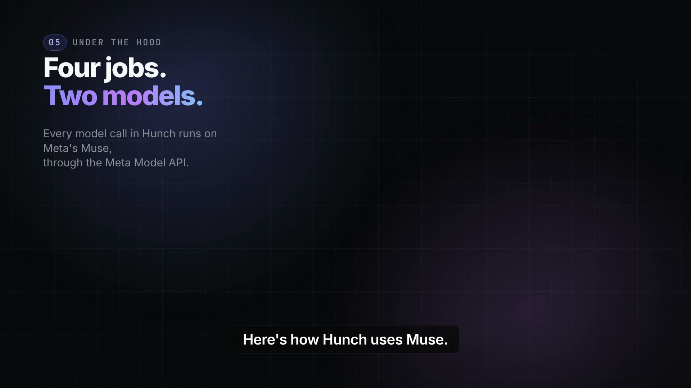

# Hunch

**Turn a thesis into a portfolio you can hold, measure and stand behind.**

Hunch takes an idea about the world, written in plain language ("AI data centres will strain the
power grid"), and turns it into a researched, guard-railed portfolio of US-listed equities. The
thesis is the unit of record: every position cites its evidence, and every weight, review, proposal
and order traces back to the idea. Every trading day Hunch checks whether the thesis still holds.
Meta's Muse models do all of its reasoning: Muse Wonder 1.0 researches each thesis, and Muse Spark
1.3 runs the Hunch Agent, the daily thesis check and the critique.

Hunch gives no investment advice: the person writes the thesis and its limits, Muse proposes
candidates, code sizes them under those limits, and money moves only at the person's own broker,
on their approval or inside autopilot limits they set. Until a pending Markets API deploy lets the
broker connector submit orders, they fill on Hunch's simulated venue.

- Watch the [three-minute film](https://youtu.be/ePFCpg3Qhgk): real screens of Muse at work in
  Hunch ([also in the repository](films/hunch-hackathon-video/hunch-hackathon.mp4)).
- Read [how Hunch uses Muse](docs/muse.md), then [a real Muse Wonder research](docs/examples/README.md)
  and the basket the guardrails built from it.
- [Check it in five minutes](#for-judges): the tests run with no credentials and no platform access.

This repository is the Hunch backend on the Main Sequence platform: the FastAPI application with
its MCP server, the Hunch Agent (a TAU Harness Agent) and the Jobs that research, build, review and
execute. The Command Center site lives in the
[`Hunch` repository](https://github.com/ms-private-projects/Hunch/tree/command-center-site).

## Why it matters

Three reasons, in the order a person feels them.

- **Sovereignty.** Someone who holds a view about the world should be able to own exactly the
  companies that express it, not a basket assembled by someone else under index rules, exclusion
  lists or stewardship policies they never chose. Hunch keeps the thesis in the person's words and
  the limits in their hands: the model proposes, code sizes, and only their approval or their own
  autopilot limits move money, at their own broker.
- **Speed.** A belief becomes a researched, evidence-cited, risk-capped portfolio in minutes, not
  after a fund launches a product for it, and it is re-checked every trading day against the
  person's own "change my mind" conditions.
- **Cost.** Thematic ETFs commonly charge 0.40% to 0.75% a year. Compounded over 40 years, 0.40%
  removes about 15% of final wealth and 0.75% about 26%, before tracking and turnover costs.
  Hunch's marginal cost is a few model calls per take per day, at a commission-free broker.

Because Hunch runs on Main Sequence, every operation is already an MCP tool behind an agent card:
a person or a team can connect their own agents to it, extend the Hunch Agent, or build their own
agent mesh around their portfolios instead of waiting for a vendor to ship the feature.

## Before and during the hackathon

Hunch is our entry to the
[Meta Global AI Developer Hackathon](https://cerebralvalley.ai/e/meta-ai-developer-hackathon),
which started on 26 October 2026 at 17:00 UTC. This repository started two days earlier, on
24 October. Its history is untouched, so every date below can be checked with `git log`.

**Before the hackathon (24 October to kickoff).** On 24 October the Main Sequence platform created
the repository from its project template (one commit, by `ms_pod`). On 25 October we built a first
working version in 17 commits, and one more commit on the morning of 26 October redeployed it to
Production:
- the Hunch tables, the API, the Agent and the workflow;
- profiles and takes;
- research, daily bars, the basket signal and practice portfolios;
- linked accounts, funding, proposals, execution, daily reviews, the leaderboard and notifications;
- performance metrics, research with citations and the email digest;
- first hosted deploys to the development and Production Environments.

Hosted research was then a heuristic that called no model, and the Agent was configured on a
non-Meta model.

**During the hackathon (26 October onwards).**
- **Meta's Muse models do all the model work.** Take research runs on Muse Wonder 1.0. The Hunch
  Agent, the daily review and the thesis critique run on Muse Spark 1.3. Each role picks its own
  model (ADR 0007), every call goes through the platform's recorded inference to the Meta Model
  API, and research answers must fill a strict schema or are retried once ([how Hunch uses Muse](docs/muse.md)).
- **Research and construction are separate Jobs** (ADR 0008). Research holds the model credential;
  the build calls no model and decides the weights in code.
- **Hunch moved to ms-markets 3.x** and now reaches the market ledger only through the Markets API
  (ADRs 0005 and 0006).
- **Hosted runs are reliable.** A build follows its Job run to the end, waits for services that
  scale to zero to wake up, and fills price history in small batches. The daily sweep starts one
  review per active take. A take rebuilt in the same session now gets its new basket (ADR 0002).
- **The product plan was rewritten** around Hunch's own ontology.
- **Two films** were written, voiced and rendered: the marketing cut
  ([`films/hunch-demo-video`](films/hunch-demo-video)) and the hackathon cut with real screens of
  Muse at work ([`films/hunch-hackathon-video`](films/hunch-hackathon-video)).
- **The documentation for judges:** this guide, [how Hunch uses Muse](docs/muse.md),
  [a take end to end](docs/walkthrough.md), and a [real research](docs/examples/README.md) with
  screenshots of the running site.

**How much was done during the hackathon.** This is measured on the repository as it stands today:

| Measure | Before 26 Oct, 17:00 UTC | During the hackathon |
| --- | --- | --- |
| Commits on `main` | 19 (the template commit and 18 of ours) | 73 (79%) |
| Lines of code, tests and docs | 71% | **29%** |

Each line counts for the commit that last wrote it (`git blame -w -M -C`), so moved lines and
whitespace changes keep their original date. Left out: the licence text, `uv.lock`, the
`requirements.txt` exported from it, the instrument universe (`src/hunch/instruments/universe.json`), the stored model answer
and its recorded request in `docs/examples`, and binary files such as the film and the screenshots. By area, 20% of the
application code, 43% of the tests and 60% of the docs were written during the hackathon.
`uv run scripts/hackathon_share.py` recomputes every number here.

The Command Center site lives in the
[`Hunch` repository](https://github.com/ms-private-projects/Hunch/tree/command-center-site) and
follows the same timeline: it was scaffolded on 24 October, its first version came on 25 October,
and 4 of its 11 commits came during the hackathon.

## For judges

This table maps each judging criterion to where the evidence is:

| Criterion | What to read |
| --- | --- |
| **Impact** | [The idea](#the-idea), the [Concepts](#concepts) and the ontology in section 1 of the [plan](docs/planning/0001-hunch-product-and-build-proposal.md) |
| **Use of Meta AI tooling** | [How Hunch uses Muse](docs/muse.md): the four roles Muse plays (the Agent, research, review and critique), how each call is made and bounded, the research contract, and what we measured on Muse. The decisions are [ADR 0007](docs/adrs/0007-model-roles-and-analysis-tools.md) and [ADR 0008](docs/adrs/0008-research-and-construction-are-separate-steps.md) |
| **Technical depth and execution** | [A take, end to end](docs/walkthrough.md): a sequence diagram, the code behind every step, the guardrails and the 189 tests by area (186 run with no credentials, 3 skip without the local MetaTables runtime). Also the [Architecture](#architecture) and eight [ADRs](docs/adrs/) |
| **Demo** | The [demo film](#demo-film), [screenshots of the running site](#the-running-site), and [a real Muse Wonder research](docs/examples/README.md) with the basket built from it |
| **The advice boundary** | Hunch gives no investment advice. The person writes the thesis and the limits, Muse proposes candidates and code sizes them, money moves only on the person's approval or inside autopilot limits they set, and the leaderboard ranks published takes by their own record since activation ([the commitments](#the-idea), [Disclaimer](#disclaimer)) |

**Check it in five minutes.** The tests need no credentials and no platform access: the model,
the broker and the market ledger are replaced by fakes, a deterministic researcher and a simulated
venue.

```bash
git clone https://github.com/ms-private-projects/HunchAPI.git && cd HunchAPI
uv sync
uv run pytest -q    # 186 passed, 3 skipped (those need the local MetaTables runtime)
uv run scripts/check_example_research.py    # the stored Muse research and its recorded request, checked against the code
```

**What is real and what is simulated, today.**

| Part | Today | Where to check |
| --- | --- | --- |
| Research, critique, daily review | Live on Muse through the Meta Model API; every call is a recorded request | [docs/muse.md](docs/muse.md), [a stored answer](docs/examples/README.md) |
| The Hunch Agent | Live on Muse Spark 1.3, acting through 16 MCP tools | [The Hunch Agent](#the-hunch-agent) |
| Weights, limits, orders | Decided in code, never by a model; 189 tests, of which 186 run with no credentials and 3 skip without the local MetaTables runtime | [docs/walkthrough.md](docs/walkthrough.md) |
| Daily prices | **Still synthetic for the demo take.** The `alpaca` bars provider (`HUNCH_BARS_PROVIDER`, default `synthetic`) reads the Alpaca connector's stored daily bars (SIP, split- and dividend-adjusted) through the runtime grant. Every bar row records its provenance (`interpolated` = synthetic), and instruments the venue lacks, such as BIL, keep synthetic bars. The connector's stored bars stop at 2026-09-04 because its nightly bars Job ran an outdated image. That Job now follows the connector's main (alpaca-connectors PR 7, merged 4 Nov), and the catch-up waits on a platform deploy. Until then returns, price facts and the leaderboard are not market data | [ADR 0009](docs/adrs/0009-daily-bars-come-from-the-connected-venue.md), [`market_data/`](src/hunch/market_data) |
| Trading | **Fills on Hunch's simulated venue**, end to end (proposals, orders, fills, reconciliation), through the same connector port the live venues use. The hosted Alpaca connector holds the paper account's keys and receives Hunch's proposals, but its order submit fails on the Production Markets API (see below) | [Status](#status), [ADR 0003](docs/adrs/0003-funding-and-execution-through-connectors.md) |
| Broker credentials | Never in Hunch: the Alpaca and Interactive Brokers connectors hold them | [Architecture](#architecture) |
| The films | Hackathon cut: the critique, research, basket, funding, daily-review and leaderboard scenes are captures of the site on the local stack (fills on the simulated venue); its opening, take form and Muse-app scenes, and the whole marketing cut, are styled cards with illustrative data, and both say so | [Demo film](#demo-film) |

**What runs hosted, and what blocks live trading.**

| | Today |
| --- | --- |
| Runs hosted | The Hunch API with its MCP server, the Hunch Agent and their Jobs, on a development Environment on Main Sequence. The Alpaca connector and the Markets API used for trading run on Production. The connector links the paper account, holds its keys (stored on 4 Nov at 13:19 UTC, imported from platform Secrets; Hunch never saw them) and receives Hunch's proposals |
| Blocks real fills | The connector's order submit fails on the Production Markets API: ms-markets 3.0.2 does not attach the OrderManager resource to its v1 runtime. The fix is released as ms-markets 3.0.3 (MainSequenceMarkets PRs 36 and 38); its Production deploy is pending |
| Blocks real prices | The connector's bars catch-up, which waits on a platform deploy; Hunch's `alpaca` bars provider is ready ([ADR 0009](docs/adrs/0009-daily-bars-come-from-the-connected-venue.md)) |
| Hosted runs on record | On development: build JobRun `4c8c75e8` with request `2e564635` and critique request `0d665f6c` (1 Nov, [ADR 0007](docs/adrs/0007-model-roles-and-analysis-tools.md)); builds `e08fe607` and `650866bb` ([ADR 0006](docs/adrs/0006-hunch-behind-the-markets-api.md)) and research `a037d2e2` ([ADR 0008](docs/adrs/0008-research-and-construction-are-separate-steps.md)) on 2 Nov |

**Muse at work, in thirty seconds.** One candidate from the [stored research](docs/examples/muse-wonder-research.json)
Muse Wonder 1.0 returned for the take "AI power and grid buildout" (recorded request
`3ac2815c-247a-4aeb-bde5-e1d8e6174ba7`, [exported in full](docs/examples/muse-wonder-recorded-request.json);
7 claims, 8 candidates, 65 evidence items), and the evidence it cites:

```json
{"ticker": "VST", "role": "pure_play", "conviction": 0.95, "citations": ["E63"],
 "case": "Vistra is listed in the universe for power, data-center, nuclear and grid themes, making its generation fleet the closest direct expression of firm power sold to meet rising load [E63]. ...",
 "risks": ["Merchant power prices may fall if new supply is built faster than demand, ..."]}
{"id": "E63", "ticker": "VST", "kind": "quant", "source": "hunch bars",
 "title": "1y return -3.5%, annualised volatility 15%, average daily volume 1,891,813"}
```

The guardrails then held VST at the take's 15% cap ([the basket](docs/examples/README.md#what-the-guardrails-built-from-it)).
For the film's take, "AI needs power", the same path ran on the local stack on 4 November: the
critique on Muse Spark 1.3 answered in 27.7 s, research 1 on Muse Wonder 1.0 in 42.3 s (request
`126463af-1d27-4017-873e-c1d4f1ecbb8a`), and the build held NextEra and Vistra at 15% with 10% cash.
Every role, model and thinking level is in [docs/muse.md](docs/muse.md#where-muse-runs), and
[`test_every_deployed_model_call_runs_on_muse`](tests/test_model_roles.py) fails if the deploy file
ever points a role elsewhere.

## How Main Sequence supports the build

Hunch is built and run on the Main Sequence platform. The platform supplies the infrastructure, so
this repository holds only Hunch's own product logic:

- **Hosting.** The platform created the repository and builds and deploys what
  `.mainsequence/workflows/hunch-api.yaml` declares: the FastAPI application with its MCP server,
  the Hunch Agent and the scheduled Jobs. Each runs in a development or Production Environment.
- **Data.** MetaTables is the database: Hunch's tables live in the `hunch` namespace, with
  migrations.
- **Market ledger.** ms-markets, through the Markets API, holds assets, accounts, calendars,
  portfolios and signals, and the contracts for portfolio time series.
- **Brokers.** The Alpaca and Interactive Brokers connectors hold the broker credentials and
  execute trades. Hunch never sees those credentials.
- **The Agent.** The TAU Harness Agent runtime runs the Hunch Agent. It acts for the signed-in
  person and can only use Hunch's MCP tools.
- **Models.** Recorded inference gives access to Meta's Muse models and records every model call.
- **Sign-in and the site.** The Command Center handles sign-in and identity for the site and every
  API call.

## Demo film

[](https://youtu.be/ePFCpg3Qhgk)

**The hackathon cut (2:59).** [Watch it on YouTube](https://youtu.be/ePFCpg3Qhgk) or
[in the repository](films/hunch-hackathon-video/hunch-hackathon.mp4). It follows a person from a
hunch to a portfolio on real screens of the Hunch site on the local stack: the thesis critique
arriving from Muse Spark 1.3, research 1 by Muse Wonder 1.0 with its roles and cited evidence, the
basket the guardrails built from it, a chapter on how Hunch uses Muse (the four jobs, the Meta
Model API, the schema, the recorded request and the test that pins every deployed model call to
Muse), the real Alpaca paper account linked through the hosted connector, a $10,000 funding whose
eight orders filled on Hunch's simulated venue, the daily review Muse Spark 1.3 answered, and the
published take on the leaderboard. The opening, the take form and the Muse-app scene are styled
cards, and Hunch inside the Muse app is labelled coming soon
([`films/hunch-hackathon-video`](films/hunch-hackathon-video)).

**The marketing cut (3:00).** [On YouTube](https://youtu.be/wKARzkQHrqU) or
[in the repository](films/hunch-demo-video/hunch-demo.mp4): the same journey told with cards in the
style of the Hunch site and illustrative data ([`films/hunch-demo-video`](films/hunch-demo-video)).

Both films were made as [HyperFrames](https://hyperframes.heygen.com) projects. To keep this
repository light, only the published cuts and their posters are committed; the projects, captures
and media stay on the team's machines.

### The running site

These screenshots were captured on 3 November 2026 from the [Hunch site](https://github.com/ms-private-projects/Hunch/tree/command-center-site)
on the local stack, with the simulated venue and synthetic daily prices:
- The research tab shows research 1 of the take "AI power and grid buildout", answered by Muse
  Wonder 1.0.
- The basket tab shows the weights the guardrails built from it.

| Research by Muse Wonder 1.0 | The basket the guardrails built |
| --- | --- |
|  |  |

The [overview](docs/screenshots/take-overview.png) and the
[revision](docs/screenshots/take-revisions.png) are in `docs/screenshots/`.
[docs/examples](docs/examples/README.md) has the full answer.

## The idea

An investment idea and the portfolio that expresses it usually drift apart: the reasons live in a
note, the positions live at the broker, and nobody checks whether one still justifies the other.
Hunch keeps them together. The thesis is the unit of record. Every weight, review, proposal and
order traces back to it, so a person can see why they own what they own, whether the reason still
holds, and how the idea has done since it went live. Ideas are also social: a take can be
published, forked by others with its lineage intact, and ranked against other takes.

**Who it's for.** It's for people with a view on where the world is going, like "AI needs power",
"water gets scarce" or "the grid gets rebuilt". Today they either buy the one obvious stock or a
broad fund, and they rarely write down why. A professional manager has analysts to research a
theme, size a basket, watch it daily and explain every change. Hunch gives a single person that
loop. Muse makes it affordable to research every take, check every thesis daily and answer every
question.

**Before and after.** Someone believes AI data centres will strain the power grid:
- **Before**, they buy one utility stock, and a month later they can't say whether the reason still
  holds.
- **With Hunch**, they:
  - write that sentence;
  - sharpen it with the Hunch Agent into claims and the conditions that would change their mind;
  - research it into candidates across power producers, grid equipment and cooling, with cited
    evidence;
  - build a basket under their own limits;
  - practise it, then fund $2,000 in approval mode;
  - approve the first trades.

  Every trading day after that, the review says whether the thesis still holds, and the take's
  record shows how the idea has done since it went live.

Three commitments shape the product:

- **The person instructs.** Hunch expresses the person's thesis and shows its evidence and
  reasoning. It is not an investment adviser, and returns earned without invested money are
  labelled simulated.
- **Non-custodial.** Money and broker credentials stay at the brokerage and in its connector.
  Hunch holds neither, and a linked account can be revoked at any time.
- **Accountable by construction.** Approval is the default, autopilot acts only within limits the
  person can see, every model call is recorded, and the model proposes while code decides weights,
  limits and orders.

## Concepts

| Concept | What it is |
| --- | --- |
| **Take** | A thesis in natural language with its constraints: horizon, cash buffer, single-name cap, maximum positions, exclusions, risk level and "what would change my mind". Private or public. |
| **Research** | A numbered study of a take against the target universe: claims, beneficiaries and losers, and candidates with a role (`pure_play`, `supplier`, `enabler`, `hedge`, `defensive`), a case, risks, a conviction and cited evidence. Research sets no weights. |
| **Evidence** | What research cites: quantitative facts computed from daily bars, news and fundamentals. |
| **Basket and revision** | The weights and cash buffer that construction derives from one research under guardrails. Every change of the basket is a revision with its rationale. |
| **Hunch portfolio** | The model portfolio that holds the basket over time and produces the take's performance since activation. |
| **Linked account** | A brokerage account at Alpaca or Interactive Brokers that the person proved they own. |
| **Execution mode** | `practice` (no orders), `approval` (the person signs off every trade) or `autopilot` (trades within visible limits). |
| **Funding** | An amount of a linked account committed to one take. |
| **Rebalance proposal** | The only way money moves: the trades that reach the target, with the person's decision or the autopilot check, and their execution state. |
| **Daily review** | The trading-day check of drift and of the thesis, ending in hold, flagged, proposed or executed. |
| **Fork and leaderboard** | A fork copies a public take into another person's control with its lineage; the leaderboard ranks public takes by return since activation. |
| **Hunch Agent** | The one conversational agent. It helps the person write, understand and act on takes through the Hunch API's tools, and never calls a brokerage. |

The full ontology, with the record behind each concept, is section 1 of the
[plan](docs/planning/0001-hunch-product-and-build-proposal.md).

## How a take moves

```text
 write ─▶ research ─▶ build ─▶ practice ─▶ fund ─▶ live ─▶ archive
 draft    numbered,    built    active_     funding  active_
          kept         │        practice             funded
                       └─ performance record starts at activation

 every trading day: drift + thesis check ─▶ hold · flagged · proposed · executed
 any time:          publish ─▶ forks ─▶ leaderboard
```

1. **Write** a take and its constraints, alone or with the Hunch Agent, which can also critique the
   thesis.
2. **Research** it. Each research is kept and numbered, so the person can research again and
   compare.
3. **Build** from a research, with no model call: guardrails (tradability, exclusions, leveraged
   products, position count, single-name cap, cash buffer) turn candidates into weights, Hunch publishes them as the take's
   signal and builds the Hunch portfolio.
4. **Practice** it: the same reviews run and no orders are sent.
5. **Fund** it from a linked account in approval or autopilot mode. The funding becomes a
   rebalance proposal; once approved, or once it passes the autopilot check, the venue connector
   places the orders and Hunch reconciles the fills.
6. **Review** it every trading day. Notifications and an optional email digest report each step.
7. **Publish** it. Others fork it, and public takes rank on the leaderboard.

[A take, end to end](docs/walkthrough.md) draws this as a sequence diagram and names the code at
each step.

## Architecture

```text
            Command Center site (sibling `hunch` repository)
              │ requests as the person          │ chat, one session per take
              ▼                                 ▼
   ┌────────────────────────────┐  MCP   ┌────────────────────────────┐
   │ Hunch API   /v1 · /mcp     │◀───────│ Hunch Agent (TAU harness)  │
   │ Hunch Jobs                 │        │ acts for the person,       │
   │ (the `hunch` package)      │        │ Hunch tools only           │
   └───┬───────────┬────────────┘        └────────────────────────────┘
       │           │            │
       ▼           ▼            ▼
   Markets API   venue        recorded inference
   (ms-markets   connectors   (one model per role:
    ledger)      Alpaca, IBKR  research, review, analysis)
```

- **ms-markets is the market ledger, reached through the Markets API.** Assets, accounts,
  calendars, portfolios, signals and funds are Markets registries that Hunch reads and writes only
  through the Markets API (ADR 0006). The time series Hunch produces live in Hunch's own instances
  of the ms-markets contracts (`hunch.series`), which Markets catalogues. Hunch tables reference
  Markets rows by foreign key; `HunchPortfolio` extends the ms-markets `Portfolio` one-to-one.
- **Connectors are the brokerage boundary, called deterministically.** Hunch services and Jobs call
  the Alpaca and IBKR connector APIs through typed clients; the Agent and the model never call a
  connector. Hunch never holds a broker credential.
- **Hunch owns portfolio and execution logic; the connected venue API executes the trades.**
- **Research and construction are separate steps** (ADR 0008). The research Job holds the model
  credential; the build Job holds none.
- **One agent.** The Hunch Agent converses and performs bounded actions through the API's MCP
  tools. Research, construction and the daily review are deterministic service code in Jobs.

## Repository layout

```text
api/app/main.py          # deployed FastAPI entry point (re-exports hunch.api.app.main:app)
api/agent/main.py        # the Hunch Agent: app = ms_tau_sdk.create_app()
src/hunch/               # the installable package
  profiles/              # HunchUserProfile, HunchUserProfileAccount, account linking (accounts.py)
  instruments/           # HunchInstrument universe (FIGI keyed) over ms-markets Assets
  market_data/           # HunchDailyBars (Hunch's ExternalPricesTS instance) and the bar providers
  research/              # research: thesis -> candidates (recorded inference or heuristic), kept per take (runs.py); construction: guardrails
  takes/                 # HunchTake, HunchTakeResearch, HunchTakeRevision and the take lifecycle
  portfolios/            # HunchPortfolio, the basket signal, the ms-markets portfolio graph, builds from a stored research
  analysis/              # analysis-only tools such as the thesis critique (ADR 0007)
  connectors/            # the venue connector port: Alpaca and IBKR HTTP clients, simulated venue
  funding/               # HunchFunding, HunchRebalanceProposal, fund and target ledger, execution
  reviews/               # HunchDailyReview and the daily review
  community/             # leaderboard snapshots and notifications
  channels/              # email digest: composition, delivery, outbox/platform/smtp senders
  operations/            # research/build/review orchestration (inline locally, Jobs hosted)
  migrations/            # `hunch.migrations:migration`, schema gate, namespace move, revisions
  series.py              # Hunch's instances of the ms-markets time-series contracts
  api/app/               # routers, services, schemas, identity, errors, capabilities, mcp_server
  agent_tools.py         # the tool catalog the API serves at /mcp
  compat.py              # shims for ms-markets and SQLite (see ADRs 0002, 0005 and 0006)
  runtime.py             # Markets API backend and the single engine start per process
src/jobs/                # Job launchers run by path (not in the wheel)
scripts/dev_stack.sh     # local stack: MetaTables, Markets API, loopback API, local Tau, the site
scripts/local_markets_api.py  # loopback Markets API, run with the ms-markets checkout's interpreter
.tau/SYSTEM.md           # the Agent's runtime instructions
.agents/                 # agent_card.json and the published skills (.agents/skills/mcp_tools)
.mainsequence/workflows/ # API, Agent and Job declarations (workflow API 3.0.0)
docs/                    # plans, ADRs and the hosted runbook
films/hunch-demo-video/  # the demo film: the published cut and its poster
tests/
```

## Install

Python 3.13 and `uv`. Dependency ranges live in `pyproject.toml`; `uv.lock` records the
reproducible resolution and `requirements.txt` is exported from it for the deployment image.

```bash
uv sync
```

Refresh `requirements.txt` after changing dependencies:

```bash
uv export --locked --no-dev --no-hashes --format requirements-txt -o requirements.txt
```

## Validate

```bash
.venv/bin/python -m pytest -q
.venv/bin/ruff check api src tests
.venv/bin/ruff format --check api src tests
.venv/bin/msm rename-preflight scan src tests api scripts   # exits 1 on any pre-3.0 ms-markets name
```

## Run everything locally

`scripts/dev_stack.sh` starts the local MetaTables API (SQLite), a loopback Markets API on
127.0.0.1:8603 (the sibling `mainsequencemarkets-*` checkout, run with its own `.venv`, which
`uv sync --all-extras` creates there), the loopback Hunch API on 127.0.0.1:8601 (it presents your
SDK sign-in on every request, so the browser and `curl` need no header), the local Tau runtime of
the Hunch Agent on 127.0.0.1:8602 and the Command Center site on 127.0.0.1:5601 (the sibling
`hunch` repository). Hunch reaches every Markets registry through the Markets API
(`MARKETS_API_URL`); scripts and tests run outside the stack need the same variable. Prepare the
runtime once:

```bash
mainsequence login
.venv/bin/metatables init --local && .venv/bin/metatables serve --local --no-open-browser &
.venv/bin/metatables --local migrations upgrade --provider msm_migrations:migration head
.venv/bin/python scripts/local_prepare_runtime.py
PYTHONPATH=src .venv/bin/python -m hunch.migrations.namespace_move --local
.venv/bin/metatables --local migrations upgrade --provider hunch.migrations:migration head
```

```bash
scripts/dev_stack.sh all      # or: markets | api | tau | site
```

Then create, research and build a take:

```bash
curl http://127.0.0.1:8601/v1/project-state/capabilities
curl -X POST http://127.0.0.1:8601/v1/takes -H 'content-type: application/json' \
  -d '{"title":"Grid storage","thesis_text":"Grid-scale batteries become the default way utilities balance renewables."}'
curl -X POST http://127.0.0.1:8601/v1/takes/<take_uid>/actions/research
curl -X POST http://127.0.0.1:8601/v1/takes/<take_uid>/actions/build
```

`POST .../actions/research` keeps the result as the take's next numbered research
(`GET .../research` lists them), and `POST .../actions/build` constructs the basket from a stored
research (`research_uid`, the latest by default), publishes it and builds the portfolio. Hosted,
each step is its own Job (`Hunch Take Research` and `Hunch Take Build`). The hosted entry point
`api.app.main:app` verifies the platform's caller assertion instead of presenting your sign-in;
call a hosted API with `Authorization: Bearer $(mainsequence auth token)`.

## Configuration

Local defaults: research and builds run inline with heuristic research, and the venue connectors
are simulated (a paper venue inside Hunch that fills orders at the last stored close and keeps its
records as a connector does).

| Variable | Purpose |
| --- | --- |
| `HUNCH_RESEARCH_MODE` | `heuristic` or `inference` (recorded model calls; needs `HUNCH_INFERENCE_ENVIRONMENT_UID`, ADR 0002) |
| `HUNCH_RESEARCH_SOURCES` | Evidence sources, default `quant`; add `finnhub` with `HUNCH_FINNHUB_API_KEY` for news and fundamentals |
| `HUNCH_INFERENCE_PROVIDER`, `_MODEL`, `_THINKING`, `_CREDENTIAL` | The recorded-inference selection every model role starts from (credential = a configured credential's `custom_id`) |
| `HUNCH_MODEL_<ROLE>` | Per-role overrides for `RESEARCH`, `REVIEW` and `ANALYSIS`, as space-separated `key=value` pairs, for example `"model=muse-wonder-1.0 thinking=medium"` (ADR 0007) |
| `HUNCH_CONNECTOR_MODE` | `simulated` or `live`; live calls `HUNCH_ALPACA_CONNECTOR_URL` / `HUNCH_IBKR_CONNECTOR_URL` |
| `HUNCH_BARS_PROVIDER` | `synthetic` (default) or `alpaca`: the Alpaca connector's stored daily bars, with synthetic bars only for instruments it lacks (ADR 0009) |
| `HUNCH_REVIEW_DISPATCH` | `job` makes the scheduled review sweep start one review Job run per active take, three at a time |
| `HUNCH_EMAIL_SENDER` | `outbox` (writes `.hunch-outbox/*.eml`), `platform` or `smtp`; `HUNCH_SITE_URL` sets the links |

The Hunch Agent's own conversation model is the Harness Agent declaration in the workflow file, not
a role. `GET /v1/project-state/configuration` reports every role.

## API

Every route requires a signed-in caller; routes read the caller only through
`hunch.api.app.identity`, and ownership follows the person the request acts for.

| Group | Operations |
| --- | --- |
| `/health`, `/v1/project-state` | readiness, capability catalog, disclaimers, configuration |
| `/v1/profile`, `/v1/profile/accounts` | the profile; linkable accounts, link, revoke, holdings |
| `/v1/instruments` | the instrument universe |
| `/v1/takes` | list, create, read, edit; actions `critique-thesis`, `research`, `build`, `activate-practice`, `refresh`, `set-execution-mode`, `fund`, `withdraw`, `review`, `publish`, `unpublish`, `fork`, `archive`; reads `research`, `revisions`, `weights`, `performance`, `funding`, `reviews` |
| `/v1/fundings`, `/v1/proposals` | fundings; proposals with `approve`, `reject` and `sync` |
| `/v1/leaderboard`, `/v1/notifications` | the ranking; the feed and `mark-read` |
| `/mcp` | the Agent's tools and the published skills |

## The Hunch Agent

`.mainsequence/workflows/hunch-api.yaml` declares one Harness Agent (`api/agent/main.py`) that acts
for the requester and sees only the `hunch` MCP tools: `hunch_project_state`, `hunch_profile`,
`hunch_query_takes`, `hunch_manage_take`, `hunch_research_take`, `hunch_build_take`,
`hunch_query_portfolio`, `hunch_analyze_take`, `hunch_query_instruments`, `hunch_accounts`,
`hunch_funding`, `hunch_proposals`, `hunch_reviews`, `hunch_leaderboard`, `hunch_notifications`
and `hunch_get_job_run_status`. Its runtime instructions are `.tau/SYSTEM.md`; its skills are
published from `.agents/skills/mcp_tools/`. Tools take no credentials and no UIDs of people,
archives need an exact `DELETE <uid>`, and long work returns a JobRun UID.

## Jobs

| Job | Schedule (UTC) | Work |
| --- | --- | --- |
| `hunch-migrate` | before every API rollout | applies `hunch.migrations:migration` |
| `hunch-take-research` | on demand | researches one take |
| `hunch-take-build` | on demand | builds one take from a stored research, no model call |
| `hunch-portfolio-refresh` (+ dispatcher) | 01:30 Tue–Sat | brings prices and portfolio values up to date |
| `hunch-daily-review` (+ dispatcher) | 13:00 Mon–Fri | drift, thesis check, proposal or autopilot execution |
| `hunch-execution-sync` | every 15 min, 13:00–21:45 Mon–Fri | order states, fills, holdings |
| `hunch-leaderboard` | 02:30 Tue–Sat | leaderboard snapshot |
| `hunch-email-digest` | 13:30 Mon–Fri | digests for people who opted in |

Only the workflow file creates Jobs and sets their schedules; every launcher except the migration
starts with the schema gate.

## Schema

The `hunch` MetaTables (the product tables and the series instances) live in the `hunch` namespace
and are applied only by this repository's provider. The ms-markets schema they reference is owned
by the ms-markets deployment. Tables catalogued before revision 0004 move to `hunch` in place
(`hunch.migrations.namespace_move`), which the `hunch-migrate` Job runs before every upgrade.

```bash
# local development database only; hosted environments run the hunch-migrate Job
metatables --local migrations upgrade --provider msm_migrations:migration head
PYTHONPATH=src .venv/bin/python -m hunch.migrations.namespace_move --local
metatables --local migrations upgrade --provider hunch.migrations:migration head
```

Workloads need `data_writer` (the migration Job `editor`) on the `hunch` namespace from its owner
and no role on `mainsequence.markets`; the workflow file declares the branch, MetaTables, Markets
API and Agent access ([docs/operations/hosted-deploy.md](docs/operations/hosted-deploy.md)).

## Deployment

`.mainsequence/workflows/hunch-api.yaml` declares the `hunch` FastAPI release (with `/mcp`), the
one `hunch-agent` Harness Agent, the Jobs above and the `hunch-migrate` Job that gates the API
rollout. The model of each role and of the Agent is set there. Deploys come only from release
tags: a push builds nothing until a tag matching `v<major>.<minor>.<patch>` points at a commit of
`main`, which then deploys to Production.

## Status

**Works today, hosted on Main Sequence** (the API and the Agent on a development Environment; the
Alpaca connector and the Markets API used for trading on Production):
- writing a take from the site;
- research on Muse Wonder 1.0, and a build from it;
- the thesis critique and the Hunch Agent on Muse Spark 1.3;
- the Alpaca paper account linked through the connector, which holds its keys and receives
  Hunch's proposals.

**Works locally end to end with the simulated venue:**
- practice;
- funding in approval or autopilot mode;
- proposals, execution and fill reconciliation, through the same connector port the live venues
  use;
- the daily review;
- publish, fork and the leaderboard;
- notifications and the email digest.

Their Jobs are deployed hosted as well.

**Next:**
- Real fills on the Alpaca paper account wait on the ms-markets 3.0.3 deploy to the Production
  Markets API.
- Interactive Brokers executes manually (ADR 0003).
- Inbound email replies wait on a platform channel (ADR 0004).
- Venue prices for the demo take wait on the connector's bars catch-up (ADR 0009).
- Hunch inside Muse as an agent is coming soon.

## Documentation

[docs/README.md](docs/README.md) indexes every document. The ones to read first:

- [docs/muse.md](docs/muse.md): how Hunch uses Muse, role by role, with the measured runs.
- [docs/walkthrough.md](docs/walkthrough.md): a take end to end, its guardrails and the tests.
- [docs/planning/0001-hunch-product-and-build-proposal.md](docs/planning/0001-hunch-product-and-build-proposal.md):
  what Hunch is, its ontology, the architecture and the delivery plan.
- [docs/planning/0002-hunch-under-the-markets-api-boundary.md](docs/planning/0002-hunch-under-the-markets-api-boundary.md):
  Hunch on ms-markets 3.x and the Markets API boundary.
- [docs/adrs/](docs/adrs/): decisions 0001 (foundation) to 0008 (research and construction are
  separate steps).
- [docs/operations/hosted-deploy.md](docs/operations/hosted-deploy.md): the hosted runbook.

## Disclaimer

Hunch does not give investment advice. The person states the thesis and authorises every trade, or
the autopilot limits that bound them. Returns shown for takes that hold no invested money are
simulated, and past performance does not predict future results.

## License

Hunch is licensed under the [PolyForm Noncommercial License 1.0.0](LICENSE.md): anyone may use,
change and share it for noncommercial purposes, and commercial use needs a licence from Main
Sequence. The rights the hackathon Organizers hold under the event's Official Rules are separate
and unaffected.
