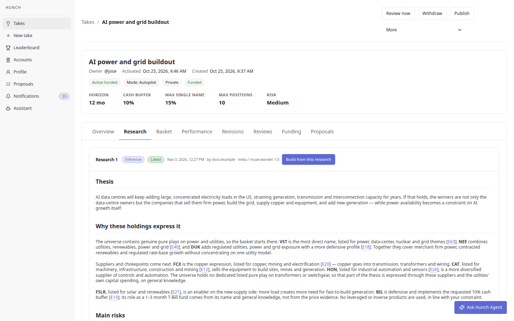
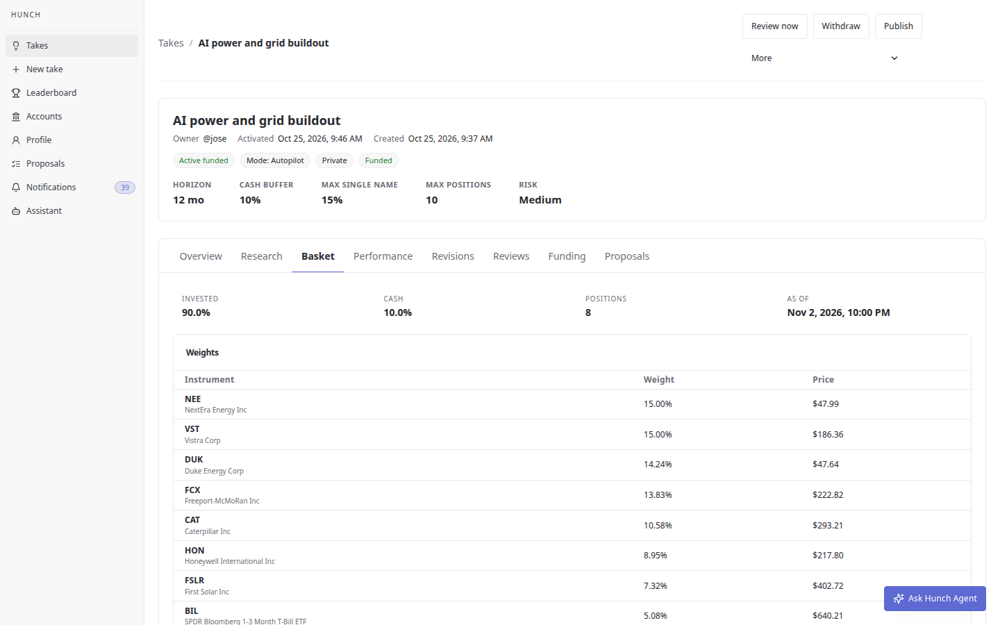

# A real research on Muse Wonder 1.0

This is one research exactly as Hunch stored it ([`muse-wonder-research.json`](muse-wonder-research.json)).
Nothing in it is illustrative: the model, the request and the answer are real.

| | |
| --- | --- |
| Take | "AI power and grid buildout", on the local stack |
| Thesis | Data centers for AI will strain the US power grid for years. Utilities, nuclear restarts, grid equipment and copper win; I want no leveraged products and a 10% cash buffer. |
| Constraints | 12-month horizon, at most 10 positions, at most 15% in one name, 10% cash, no leveraged products, medium risk |
| Model | `meta` / `muse-wonder-1.0`, thinking `medium`, the `research` role |
| How | One recorded-inference request (`3ac2815c-247a-4aeb-bde5-e1d8e6174ba7`) through the development Environment's Meta credential, run by [`run_take_research`](../../src/hunch/research/runs.py#L81) against the local stack |
| When | 2026-11-03 11:27:25 UTC; the platform recorded 30.2 seconds from request to answer, and it needed no retry |
| Evidence offered | 65 price facts computed from the stored daily bars (`quant`). Those bars are synthetic today (a deterministic series per instrument), so the price facts are not market data; no news source was configured |

## The recorded request, and a check anyone can run

[`muse-wonder-recorded-request.json`](muse-wonder-recorded-request.json) is the platform's own
record of request `3ac2815c-247a-4aeb-bde5-e1d8e6174ba7`, exported on 4 November 2026 through
`GET /api/v1/inference/requests/<uid>/`. It holds the system and user prompts, the JSON schema, the
model, the thinking level, the metadata, the answer, the token usage (5,135 in, 2,790 out) and the
timestamps. Only the UID of the credential is redacted. The platform records the thinking level
but no reasoning trace, so there is none to export.

```bash
uv run scripts/check_example_research.py    # 15 checks, no credentials: "All checks passed."
```

The [script](../../scripts/check_example_research.py) uses Hunch's own code, not copies of it. It
checks that:
- the answer matches the research schema;
- every ticker is in the universe and every cited evidence id is in the stored evidence;
- the recorded prompts and schema are exactly what the code builds today;
- the recorded answer is the stored one.

## What came back

**Claims the take depends on**: the checkable statements that must hold for the take to pay off.

1. US AI data-centre construction materially increases electricity demand over the next 12 months and beyond.
2. New data-centre load strains generation, transmission and interconnection capacity in key US regions.
3. Utilities and independent power producers can charge for, or invest profitably against, rising power demand.
4. Nuclear restarts and existing nuclear fleets gain value as sources of firm, carbon-free power for data centres.
5. Grid buildout increases demand for transformers, switchgear, automation, construction machinery and transmission.
6. Electrification and grid expansion increase copper demand for wiring, motors, transformers and transmission lines.
7. Power constraints, permitting and interconnection delays become a bottleneck for new AI data centres.

**Candidates.** Each has a role, a case, risks, a conviction and the evidence ids it cites. The
risks are in the JSON.

| Ticker | Role | Conviction | Case | Cites |
| --- | --- | --- | --- | --- |
| VST | `pure_play` | 0.95 | Vistra is listed in the universe for power, data-center, nuclear and grid themes, making its generation fleet the closest direct expression of firm power sold to meet rising load [E63]. This rests on general knowledge that Vistra operates merchant nuclear, gas and other generation rather than only regulated distribution. | E63 |
| NEE | `pure_play` | 0.85 | NextEra is listed for utilities, renewables, power and grid themes, so regulated utility investment plus contracted renewables directly benefit from more load and grid spend [E40]. This rests on general knowledge that it combines a large Florida utility with a major renewables and transmission developer. | E40 |
| DUK | `pure_play` | 0.70 | Duke Energy is listed for utilities, power, grid and defensive themes, giving regulated exposure to load growth, transmission and distribution upgrades in the US Southeast and Midwest [E18]. Its business is electricity delivery and generation, not a side division. | E18 |
| FCX | `supplier` | 0.85 | Freeport-McMoRan is listed for copper, mining and electrification, and copper is a core input for transmission, transformers, motors and data-centre wiring [E20]. This rests on general knowledge that Freeport is one of the largest copper producers. | E20 |
| CAT | `supplier` | 0.65 | Caterpillar is listed for machinery, infrastructure, construction and mining, selling equipment used to build power plants, transmission, mines and data-centre sites [E12]. It also rests on general knowledge that Caterpillar sells power-generation equipment including large gensets. | E12 |
| HON | `supplier` | 0.55 | Honeywell is listed for industrial, automation, aerospace and sensors, supplying controls, sensing and building and industrial automation that help manage power use and grid-connected facilities [E26]. This is a secondary supplier exposure, not a dedicated grid-equipment pure play. | E26 |
| FSLR | `enabler` | 0.60 | First Solar is listed for solar and renewables and, on general knowledge, supplies utility-scale solar modules that can add generation where data-centre load is growing [E21]. It expresses the new-supply side of the power shortage rather than regulated grid ownership. | E21 |
| BIL | `defensive` | 0.50 | BIL is the SPDR Bloomberg 1-3 Month T-Bill ETF in the universe, used here for the requested 10% cash buffer rather than for the power thesis [E10]. That cash-like role rests on general knowledge of short-term Treasury bills; the quant evidence only covers its trading history. | E10 |

**The evidence it cited.** These facts come from the synthetic daily bars, which is why a
T-bill fund shows a year of -12.3% at 26% volatility. Real bars would show neither.

| Id | Ticker | Fact |
| --- | --- | --- |
| E10 | BIL | 1y return -12.3%, annualised volatility 26%, average daily volume 1,940,899 |
| E12 | CAT | 1y return +20.2%, annualised volatility 30%, average daily volume 1,986,227 |
| E18 | DUK | 1y return +2.4%, annualised volatility 23%, average daily volume 1,960,272 |
| E20 | FCX | 1y return +0.2%, annualised volatility 32%, average daily volume 2,067,650 |
| E21 | FSLR | 1y return +30.0%, annualised volatility 21%, average daily volume 2,015,271 |
| E26 | HON | 1y return -13.5%, annualised volatility 22%, average daily volume 2,068,932 |
| E40 | NEE | 1y return +46.0%, annualised volatility 32%, average daily volume 2,116,728 |
| E63 | VST | 1y return -3.5%, annualised volatility 15%, average daily volume 1,891,813 |

## Checks on this answer

- **The contract held on the first call.** The answer has 7 claims (the
  schema allows 1 to 10) and 8 candidates (3 to 20), and every case is filled.
  So the retry described in [ADR 0008](../adrs/0008-research-and-construction-are-separate-steps.md)
  was not needed.
- **It stayed inside the universe and the constraints.**
  - Every ticker is in Hunch's universe.
  - No leveraged or inverse product appears.
  - It added a T-bill fund (BIL) as a defensive holding for the cash buffer. The guardrails keep
    the 10% buffer in cash regardless, so about 15% of the basket ends up cash-like.
- **It said where evidence ran out.** The universe holds no listed pure play on transformers or
  switchgear, and the rationale says so. It also marks what rests on general knowledge rather than
  on the cited evidence.
- **It sets no weight.** Weights come from the guardrails when the take is built from this research
  ([`construct_basket`](../../src/hunch/research/__init__.py#L63)), not from the conviction numbers
  alone.

## What the guardrails built from it

The take was then built from this research, with no model call. The guardrails sized each
candidate by its conviction times a factor for its role (pure play 1.0, supplier 0.8, enabler 0.6,
defensive 0.5), under the take's limits:
- capped NEE and VST at the 15% single-name limit;
- kept 10% in cash;
- reported `8 positions, 90.0% invested, 10.0% cash.`

| Ticker | Role | Weight |
| --- | --- | --- |
| NEE | `pure_play` | 15.00% |
| VST | `pure_play` | 15.00% |
| DUK | `pure_play` | 14.24% |
| FCX | `supplier` | 13.83% |
| CAT | `supplier` | 10.58% |
| HON | `supplier` | 8.95% |
| FSLR | `enabler` | 7.32% |
| BIL | `defensive` | 5.08% |
| Cash | | 10.00% |

The site shows the same research and basket. These screenshots were captured on 3 November 2026
from the Hunch site on the local stack, and the prices in them are synthetic:
[research](../screenshots/take-research.png), [basket](../screenshots/take-basket.png),
[revision](../screenshots/take-revisions.png), [overview](../screenshots/take-overview.png).





## The rationale, as the person reads it

### Thesis

AI data centres will keep adding large, concentrated electricity loads in the US, straining generation, transmission and interconnection capacity for years. If that holds, the winners are not only the data-centre owners but the companies that sell them firm power, build the grid, supply copper and equipment, and add new generation — while power availability becomes a constraint on AI growth itself.

### Why these holdings express it

The universe contains genuine pure plays on power and utilities, so the basket starts there. **VST** is the most direct name, listed for power, data-center, nuclear and grid themes [E63]; **NEE** combines utilities, renewables, power and grid [E40]; and **DUK** adds regulated utilities, power and grid exposure with a more defensive profile [E18]. Together they cover merchant firm power, contracted renewables and regulated rate-base growth without concentrating on one utility model.

Suppliers and chokepoints come next. **FCX** is the copper expression, listed for copper, mining and electrification [E20] — copper goes into transmission, transformers and wiring. **CAT**, listed for machinery, infrastructure, construction and mining [E12], sells the equipment to build sites, mines and generation. **HON**, listed for industrial automation and sensors [E26], is a more diversified supplier of controls and automation. The universe holds no dedicated listed pure play on transformers or switchgear, so that part of the thesis is expressed through these suppliers and the utilities' own capital spending, on general knowledge.

**FSLR**, listed for solar and renewables [E21], is an enabler on the new-supply side: more load creates more need for fast-to-build generation. **BIL** is defensive and implements the requested 10% cash buffer [E10]; its role as a 1–3 month T-Bill fund comes from its name and general knowledge, not from the price evidence. No leveraged or inverse products are used, in line with your constraint.

### Main risks

- Power demand from AI could grow more slowly than expected, or efficiency gains could reduce electricity per unit of compute.
- Utilities may not earn attractive returns if regulators resist rate increases or financing costs stay high.
- New generation, storage or transmission could arrive faster than expected, easing scarcity and merchant power prices.
- Copper and construction names are cyclical and can fall with the wider economy even if the long-term grid story is intact.
- Individual risks include nuclear outages at VST, rate-case outcomes at DUK and NEE, and policy or tariff changes for FSLR.

### What would change my mind

Evidence that US data-centre power demand is being cancelled or sharply delayed, that interconnection and grid investment are no longer bottlenecks, that utilities are unable to recover grid spending in rates, or that copper demand from electrification is weakening would undermine the take. Conversely, faster load growth alone would not fix poor regulatory returns — both demand and allowed returns need to hold.

*This is research to support your decision, not investment advice, and it does not promise returns.*
