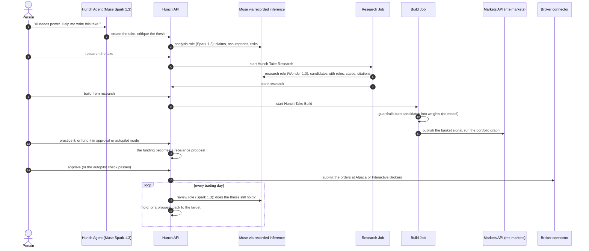

# A take, end to end

This page follows one take from a sentence to a traded portfolio and names the code at each step.
[How Hunch uses Muse](muse.md) covers the model calls in depth, and the
[ADRs](adrs/) record the decisions.



## The steps and their code

| Step | What happens | Code | Model |
| --- | --- | --- | --- |
| Write | The person writes the thesis and its constraints (horizon, exclusions, single-name cap, positions, cash buffer, risk, what would change their mind), alone or with the Agent | [`create_take`](../src/hunch/takes/services.py#L150), the Agent's tools in [`agent_tools.py`](../src/hunch/agent_tools.py) | Agent: Spark 1.3 |
| Critique | An analysis-only read of the thesis: claims and their strength, assumptions, counterarguments, risks, questions. It changes nothing | [`critique_thesis`](../src/hunch/analysis/services.py#L351) | `analysis`: Spark 1.3 |
| Research | The take is researched against the instrument universe with cited evidence and kept as a numbered research. It sets no weight | [`run_take_research`](../src/hunch/research/runs.py#L81), [`inference_research`](../src/hunch/research/inference.py#L291) | `research`: Wonder 1.0 |
| Build | The guardrails turn the candidates into weights. Hunch publishes them as the take's signal and builds the model portfolio on ms-markets | [`build_take`](../src/hunch/portfolios/build.py#L70), [`apply_guardrails`](../src/hunch/research/guardrails.py#L66), [`PortfolioGraph`](../src/hunch/portfolios/graph.py#L129) | none |
| Practice | The take goes live with no money; its performance record starts and is labelled simulated | [`activate_practice`](../src/hunch/portfolios/build.py#L191) | none |
| Fund | An amount of a linked account becomes a rebalance proposal: the trades that reach the target | [`fund_take`](../src/hunch/funding/services.py#L369), [`propose`](../src/hunch/funding/services.py#L449) | none |
| Approve or autopilot | The person approves, or the proposal must pass the limits they set | [`approve_proposal`](../src/hunch/funding/services.py#L576), [`autopilot_check`](../src/hunch/funding/services.py#L316) | none |
| Execute | The venue connector places the orders; a Job reconciles fills and holdings every 15 minutes | [`submit_proposal`](../src/hunch/funding/services.py#L636), [`sync_proposal`](../src/hunch/funding/services.py#L715), [`connectors/`](../src/hunch/connectors/) | none |
| Review | Every trading day: the drift against the target and the thesis against new evidence. The verdict is `hold`, `rebalance` or `thesis_change`, and a rebalance becomes a proposal | [`review_take`](../src/hunch/reviews/services.py#L233), [`dispatch_reviews`](../src/hunch/operations/reviews.py#L94), [`proposal_from_review`](../src/hunch/funding/services.py#L874) | `review`: Spark 1.3 |
| Share | A public take can be forked with its lineage and ranks on the leaderboard by return since activation | [`publish_take`](../src/hunch/takes/services.py#L194), [`fork_take`](../src/hunch/takes/services.py#L222), [`snapshot_leaderboard`](../src/hunch/community/leaderboard.py#L66) | none |

## Guardrails

- **The model proposes, code decides.** Weights come from the guardrails, never from the model.
  The guardrails:
  - drop a ticker that is outside the universe, not tradable, or excluded by the person;
  - keep leveraged and inverse products out unless the constraints allow them;
  - enforce the position count, the single-name cap and the cash buffer;
  - write a note for every decision, and the revision keeps it.
- **No model touches money.** Only `hunch.funding.services` submits orders, and only for one of
  three reasons:
  - an approved proposal;
  - a proposal that passed the autopilot check;
  - a withdrawal.

  The Agent and the model never call a broker connector.
- **Non-custodial.** Broker credentials stay in the connector. Hunch decides who owns a linked
  account from its own link table, never from a request body.
- **Bounded agent.** The Agent sees only Hunch's tools. They take no credentials and no UIDs of
  people, and archives need the exact text `DELETE <uid>`.
- **Accountable.** Every model call is recorded by the platform. Every basket change is a revision
  with its rationale and the research it came from.

## Tests

The suite holds 186 tests. 183 run with no credentials and no platform access; 3 need the local
MetaTables runtime and skip without it (`HUNCH_LOCAL_RUNTIME_TESTS=1`).

| Area | Tests |
| --- | --- |
| Market data and the Markets API boundary | 42 |
| API, request identity, MCP and the Agent's tools | 40 |
| Model calls: roles, research, critique, evidence | 37 |
| Takes, construction and portfolios | 35 |
| Reviews, community and email | 17 |
| Funding, proposals and connectors | 13 |
| Local runtime end to end (rebuild, funded take) | 2 |

```bash
uv sync
uv run pytest -q
```
